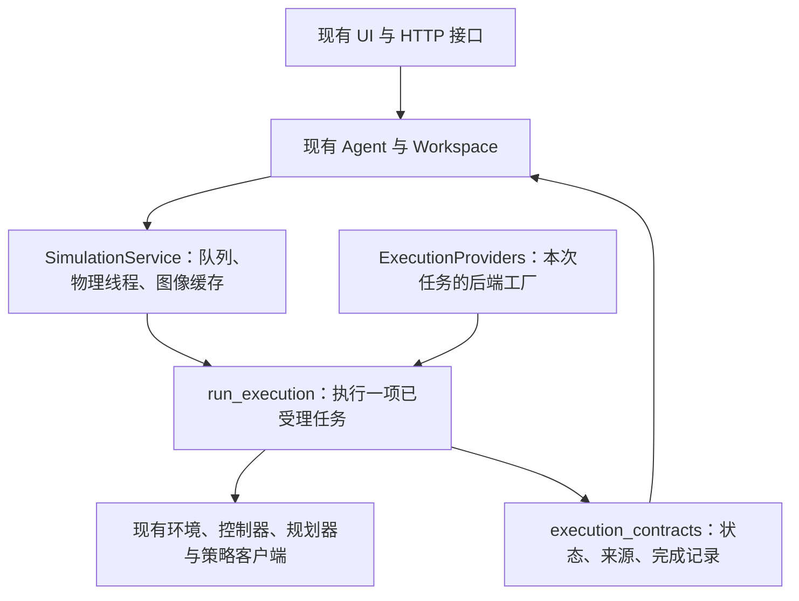

# Harness 结构与本次重构

2026-11-01 调研与实施，分支：`refactor/harness-runtime`。

## 调研得到的可用设计

比较依据是公开接口、运行边界、记录与测试说明，不按星数判断，也没有把上游项目的演示当作本平台验证。

| 项目 | 可以借鉴什么 | 本次如何采用 | 适用限制 |
| --- | --- | --- | --- |
| [PhyAgentOS](https://github.com/PhyAgentOS/PhyAgentOS-core) | [Forge 合同](https://github.com/PhyAgentOS/PhyAgentOS-core/blob/main/docs/forge/README.md)区分查询、动作和会话；任务记录与实际执行有明确归属；取消被接受不等于已经停止 | 分开执行宿主、执行循环和终态记录，沿用本平台已有取消与验证规则 | Core 不包含完整机器人技能和仿真资产；完整接入还有 Gateway、Dora 与锁定资源依赖。没有直接安装整套 OS |
| [NVIDIA ASPIRE](https://github.com/NVlabs/ASPIRE) | [接口说明](https://github.com/NVlabs/ASPIRE/blob/main/docs/api-reference.md)区分程序可用工具、环境生命周期和后台 provider；内部模拟器不直接作为模型工具 | 使用显式的执行宿主接口和按次绑定的 provider 集合，不把 HTTP 或模型循环放进执行器 | 它是技能代码发现系统，本平台当前仍使用已有工具调用与技能栈 |
| [VLA evaluation harness](https://github.com/allenai/vla-evaluation-harness) | [Python API](https://github.com/allenai/vla-evaluation-harness/blob/main/docs/python-api.md)分离模型服务、评测编排与结果；环境循环由 harness 管理 | 保留原有策略客户端和时钟契约，执行器仅组合已配置后端 | 它侧重统一评测，不能直接替代我们的交互 UI 和双臂控制 |
| [ROSClaw](https://github.com/ros-claw/rosclaw) | [架构](https://github.com/ros-claw/rosclaw/blob/main/ARCHITECTURE.md)强调执行记录、能力 provider 与独立验证 | 保留事实记录与任务成功判断的边界，不把工具退出直接升级成任务成功 | 仓库自述为 alpha，多个路径仍有待验收；作为设计参考，不作为真机可用性保证 |

PhyAgentOS 的发布说明、核心文档和部分合同分别有自己的版本标记，实际接入仍应固定代码和资源版本。本次只借鉴已经明确说明的边界，不复制其平台、自动进化系统或资源市场。

## 平台已有的能力

本平台原来已经具备技能注册、任务计划、观测身份、实例级规划器注入、执行记录和独立完成条件。重复引入第二套任务数据库或成功状态机，会增加两个结果来源不一致的风险。

本次选择拆分 `sim/service.py` 中的执行职责。它原来同时包含线程队列、画面发布、策略连接、TAMP/回放循环和终态打包，修改一种后端时必须进入同一大段函数。

## 现在的结构



- `sim/service.py`：继续拥有唯一物理线程、命令队列、取消信号、图像缓存和原来的服务方法。`_run()` 保留为兼容入口，开始任务时绑定当前 provider。
- `sim/execution.py`：接管原来的规划、策略和回放循环。`ExecutionHost` 描述它需要的宿主接口；不可变的 `ExecutionProviders` 传入策略配置读取、策略客户端、计时器和回放工厂。执行仍发生在原调用线程。
- `harness/execution_contracts.py`：仅依赖标准库，统一已有的执行终态、规划器来源和完成记录格式。它不加载 MuJoCo、模型、HTTP 或设备，也不替模型宣布用户目标完成。
- `harness/execution_contract_checks.py`：检查终态证据隔离、相机记录范围、未记录任务不复用旧图，以及实例注入和旧默认替换点的兼容性。

现有 `execution_lifecycle`、`planner_provenance` 仍可从 `sim.service` 导入。原来的规划器选择、控制动作、计时模式、终止条件与对外字典字段保持原行为；没有增加第二个物理循环。服务主体从637行降为395行，复杂度被按职责拆开，并非宣称算法性能提升。

## 兼容范围与验证方式

开始前记录了已有工作区的文件哈希和 main 的提交。工作区原来已有 UI、部署、标定等未提交改动；这些内容作为用户已有状态保留，不混作本次重构成果。

本次已有文件只修改 `sim/service.py`，另增加两个运行模块、一个检查模块和本文档。UI、HTTP 路由、模型与物理资产、控制器、策略配置、规划器、真机部署文件均与开始时逐文件核对。main 的提交引用保持原值，所有工作位于新分支；没有部署或重启共享服务器。

重构前先运行以下73项检查，重构后重复相同命令：

```sh
MUJOCO_GL=egl OMP_NUM_THREADS=1 .venv/bin/python -B -m unittest \
  harness.execution_receipt_checks harness.runtime_composition_checks \
  sim.timing_checks sim.planning_checks
```

两次均73项通过。以下补充检查66项通过，重构后两组共139项；这些检查在保留用户已有修改的当前工作区运行。

兼容检查覆盖新增执行合同、技能目录、目标约束、策略输入输出、原生后端拒绝条件、决策计时和服务器接口：

```sh
MUJOCO_GL=egl OMP_NUM_THREADS=1 .venv/bin/python -B -m unittest \
  harness.execution_contract_checks harness.skill_registry_checks \
  harness.goal_checks sim.policy_checks sim.backend_checks \
  sim.decision_checks deploy.server.checks
```

这些是软件与局部仿真回归，不是上游 PhyAgentOS 的部署验收，也不是新的机器人任务成功率实验。运行日志和开始时的文件清单位于本地 `.runtime/harness-refactor/`；其中只有本次检查材料，没有模型密钥。

后续再按需要拆后端适配器或建立独立实验接口，每次继续通过现有 UI 和动作合同验证。当前没有把不同控制器强行改成同一种动作语义，也没有更改技能、时钟或评分条件来换取通过。
