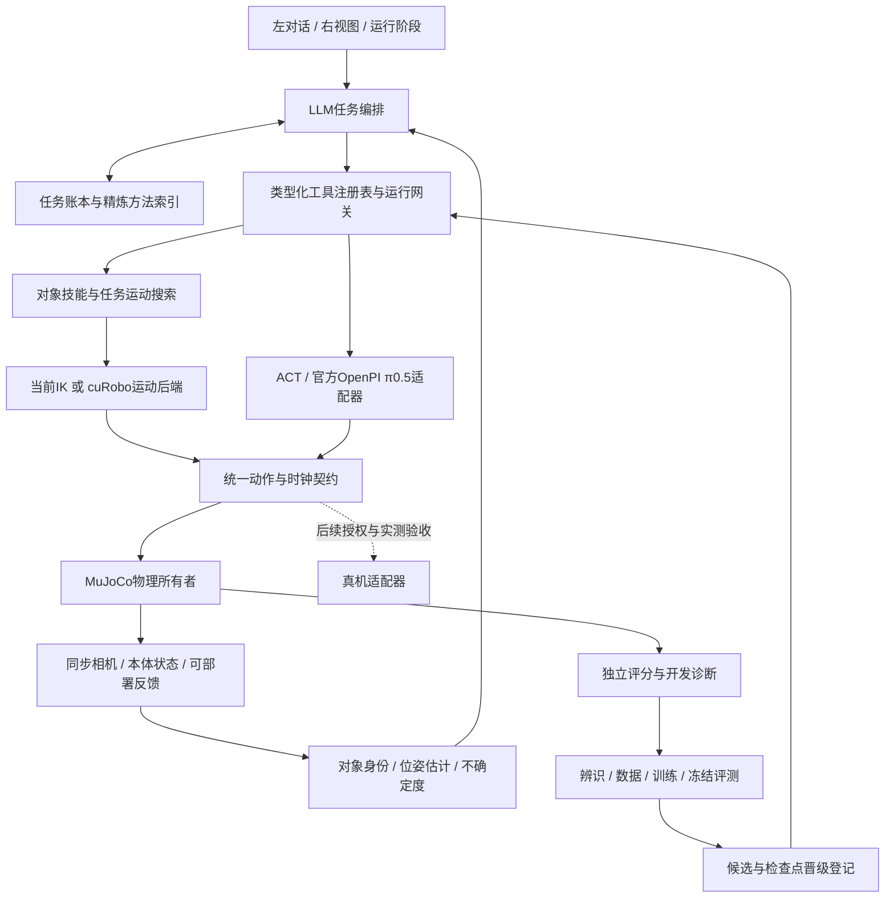

# OpenArmSim 长期执行计划

日期：2026-10-13。项目：`/home/wsk/gpt+vla/OpenArmSim`。

本文件起草时只制定了计划，没有修复驱动、启动服务或改动平台；2026-10-13已开始按编号执行。当前状态和证据见[执行交接](交接.md)及本文件的执行进度表。[旧路线图](路线图.md)与原实验报告保留历史结果；状态冲突时以最近的现场检查为准。

## 1. 接手摘要

目标是：自然语言任务进入 agent，agent根据新观测选择参数化技能或兼容的 ACT/π0.5策略，接收执行反馈、复查和恢复；同一个机器人接口连接当前 MuJoCo 仿真和将来独立授权的真机。界面固定为左对话、右上视图、右下阶段与关键帧。

近期交付先达到“可靠的仿真工具与模型工作台”：旧演示保留；左右手、位置、物体和动作组合能在声明范围内变化；ACT可被选择且能解释失败；π0.5有官方实现的可核验接入路径；过程和记忆简洁可查。真实迁移作为需要实测与配对真机评价的独立交付。

下一轮只执行 **P0 环境与基线恢复**。P0通过后进入P1；不要一开始重训π0.5或安装整套新仿真引擎。

每完成一个编号小项：重新读取本节、当前小项及验收条件，对照计划复查；记录证据和下一步后才继续。无需反复加载全部历史README和长数组。

### 首次执行前的环境快照

| 项目 | 2026-10-13检查结果 | 对后续执行的影响 |
|---|---|---|
| 本机服务 | 8765、8767的`/health`与`/api/status`连接失败 | 原因尚未诊断；先找启动方式、进程、端口与日志，不能沿用旧“ready”记录 |
| NVIDIA | `nvidia-smi`无法与驱动通信 | 不能据此断言显卡损坏或缺某个模块；GPU规划、ACT与π0.5前先诊断环境 |
| 模型文件 | 本地ACT权重文件存在；`models/pi05/checkpoint/model.safetensors`不存在 | 文件存在、服务就绪、真实推理、任务成功分别验收 |
| 技能契约 | 当前`run_policy`仍声明`atomic_right_to_left_handover`，不能接受任意子任务 | 单个交接权重不会因为换提示词就学会左→右或任意搬运 |
| 运行架构 | `tools/object_workbench.py:build_backend`串联多层`install_isolated`及工厂包装 | 先列依赖和行为，再逐段迁移到明确注册表；保留旧组合回归 |
| 手动工具 | 源码已有`move_to_pose`、`move_relative`、`set_gripper`、抓取/交接/放置等 | 不重做已有能力；检查后端是否运行、前置条件与参数绑定 |
| 标定与模型效果 | 10月11日审计与旧回合结果仍是历史证据，本次未重跑 | 不能把仿真软件匹配、ACT可推理或固定案例成功写成真机迁移通过 |
| 同事包 | `handoff/`的瘦身包不含个人运行环境、策略权重与历史`runs/`；曾通过便携检查及TAMP抓取 | 包与完整工作区不同；完整开发测试有历史产物依赖，需在P0拆分便携测试与档案审计 |

机器此前配置记录为16GB显存；驱动仍不可用，未重新确认GPU型号和实际可用容量。上面的首次环境快照中，HTTP 402仍是10月11日历史记录；2026-10-13随后进行的两次文本探测结果见P0.4与[API阶段路由记录](../runs/20261013-agent-routing/README.md)。

### 2026-10-13至14执行进度

| 小项 | 状态 | 当前证据与下一步 |
|---|---|---|
| P0.1 驱动/启动诊断 | 已验收（不含策略任务效果） | 根因为内核`7.0.0-38`缺匹配模块；已安装NVIDIA 595.99.02及对应模块，升级20包、安装2包、移除旧模块，未重启。`nvidia-smi`识别RTX 5060 Ti（16,311 MiB）；CuRobo环境PyTorch 2.11.0+cu128完成CUDA张量分配/计算。受管重启后MuJoCo服务、ACT接口和cuRobo worker报告ready。ACT推理和cuRobo具体运动任务仍未通过。CUDA运行时读取LeberoAct本机环境，未写入该目录。 |
| P0.2 日常入口与进程所有权 | 已验收 | `./run start`、`./run stop`管理8767对象工作台；健康接口带工作台、源码版本、配置档和ACT/cuRobo连接状态。完成正常启停、SIGKILL后的自动恢复、任务不续跑、源码变化时工具请求409拒绝。systemd服务按实际项目目录生成，前台调试可覆盖端口。详细结果见`runs/20261013-runtime-lifecycle/README.md`。 |
| P0.3 源码、测试资料与交接包 | 已验收（随代码修复重打包） | 本地提交`e064da5`，无远端；`openarm_mujoco`固定上游提交`c69cad6`。修复后包包含逐请求工具白名单，669项文件哈希、参考数据回放和固定TAMP抓取smoke在临时干净解压副本通过；ZIP SHA256 `bc10cb8748072b74d89d1ef37851e3b0b376e047c63d01c61fcfc009511d1385`。排除API配置/权重/历史runs；新安装按解压目录生成用户服务配置。依赖复用本机`.venv`，全新pip安装尚未验收。详见`handoff/README.md`、[验证矩阵](验证矩阵.md)。 |
| P0.4 冻结现有回归 | 已验收（缺口已登记） | [基线清单](基线清单.md)固定历史成绩与范围。新增[多目标 TAMP 扫描](../runs/20261013-tamp-target-sweep/README.md)：固定瓶子/桌面下24组首次18成功；6个左手携物放置失败，在同一状态换手后6/6恢复；不合并为泛化率。另有[模型/API阶段路由复核](../runs/20261013-agent-routing/README.md)：API请求HTTP 402；工具白名单已修复。 |
| P1.1 SkillSpec与可用性目录 | 已验收（接口/合同；视觉点击未验） | 新增`harness/skill_registry.py`：从当前模型工具白名单生成技能参数、对象/手臂范围、先决条件、效果、观测来源、证据等级、超时/取消语义及逐提供器状态；过时目录项不再展示。`/api/skills`与模型暴露的技能使用同一运行列表。ACT在线不会使未选中的π0.5显示在线；连接和任务效果分开。4项注册表定向测试、`node --check ui/agent.js`和209项核心回归通过；本地只读`/api/skills`返回14项。没有发真实模型API请求或运动命令。 |
| P1.2 统一请求/回执 | 已验收（合同、回归、现场部署） | `1fd08ee`为该小项代码提交。SQLite回执绑定task/root/execution、观测ID与epoch、skill/backend、对象/手臂/frame/目标、锁定目标和预算；保存前后观测与终态证据。生命周期区分accepted、planning、executing、verifying、succeeded、failed、cancelled，拒绝单独标记。任务内同一技能与目标在新观测后重复提交会在派发前拒绝；改变目标可继续。重规划沿用task/目标/预算，进程重启将未终结回执标记interrupted且不续跑。新增5项定向合同测试，`./run check`共214项通过；8767受管重启后源码新鲜、空闲、tick 0，can/block选择保留。没有真实API请求、真机动作或GPU策略任务。 |
| P1.3 渐进替换多层包装 | 进行中（组合审计、服务/插件依赖隔离及冗余安装清理） | 首轮审计`e4cb21d`；请求transport`c180082`；policy trace`2c47cca`；环境注入`8be49f6`及选择类型修复`d7dfe6a`；TAMP路由绑定`1ea261a`、派发回归`d949148`；持握稳定planner组合`67cc0fb`；遮蔽路由清理`794eec5`；task-placement服务组合`9b5dd2d`；自由交接planner本地组合`eb174dd`；障碍抓取planner本地组合`117cfc8`；桌面放置planner与目录拆分`3db26b9`；relocation planner服务绑定`704b595`；移除被cache子类覆盖的scene-curobo安装`54bf2d6`；CuRobo服务绑定`a682128`；cache transport与8005 metadata provider服务注入`d78659e`。工作台按服务选择CuRobo worker与同端点metadata，默认入口不再全局覆写`sim.service.CuRoboPlanner`、`scene_curobo.BASE_CALL`或`object_curobo.call`。最新`./run check`为251项通过（63.889秒）；受管重启后8767 ready/source_current，源码SHA256 `7761fec0399a0ffea7d2ce35885fcd5485ff045ae153e5ee2bc8187b6089270b`、267个源码文件；TAMP/relocation/CuRobo活动类分别为SettledHold、GeometricRelocation、CacheCuRoboPlanner，CuRobo状态来自8005；planner顺序`connected_placement → margin_grasp → free_transport → task_placement → settled_hold`。`backend_composition_order`记录cache composer，global安装顺序不再包含它。job为空、tick 0、can/block保留。没有真实API、策略推理、CuRobo运动任务或真机动作。 |
| 当前门槛 | P1.3 剩余模块级组合副作用 | 可继续 | 对照原计划验收项“启动组合顺序清晰；同一插件重复安装行为有定义；没有候选被隐式导入就更换默认控制器；失败能追到实际类/配置/版本”，继续审计默认入口其余全局安装器，区分明确工具/schema注册与意外模块类/函数替换，再逐层按fixture迁移。真实API闭环、任务效果/泛化、页面视觉验收和实物标定仍分别未通过。 |

## 2. 长期固定条件

1. 公司SSH电脑只读。可在既有授权范围读取/导出已有文件到本地；不在远端写缓存、安装环境、训练、推理或启动机器人，不导入可能操作设备的部署模块。已有真机源码导出只作审计材料。
2. 真机运动、CAN访问和新增实测采集另有作用范围。驱动修复保留用户此前“暂不重启”的约束；计划本身不授权自动重启，也不恢复已停止的定时启动。
3. 现有TAMP固定演示作为独立基线保留。扩展技能与演示分别命名、统计；模型/API失败不自动转演示继续宣布成功。
4. 独立MuJoCo所有者推进物理状态；规划、碰撞搜索和预测在副本上进行。不得用对象瞬移、写回关节位姿、隐藏对象碰撞或实时焊接刚体制造抓取成功。
5. 不因失败放宽已有目标、动作范围、接触、稳定或非目标物体约束。门槛需要调整时，先说明测量依据并建立新版本，不能与旧成绩合并。
6. 所有成绩注明模式、模型/控制/相机版本、初态、任务、预算、样本数与判定方式。推理通过≠任务通过；工具通过≠整项任务通过；仿真通过≠真实通过。
7. 原始审计证据留在实验档案；默认LLM上下文和用户记忆面板只呈现有用摘要。删除/忘记方法应立即影响检索；不靠清空失败记录改善结果。
8. 沿用本机MuJoCo和原生前端。新依赖必须解决已经量化的问题；不默认迁移到Isaac/OmniGibson/SAPIEN或重建React项目。
9. 文件归入现有`harness/`、`sim/`、`ui/`、`tools/`、`docs/`、`models/`和`runs/日期-主题/`。每轮一个主题目录；只清理自己创建且已确认无用的临时文件。

## 3. 开源依据与采用方式

以下是2026-10-13查阅的第一手论文、仓库和官方文档。查阅不等于完整复现；上游成绩、训练分布与机器人平台不能直接当作我们的指标。执行时再固定实际使用的commit、许可证与API版本。本次GitHub树API读取未成功，不提供推测的远端HEAD哈希。

| 参考 | 查阅范围与可借鉴内容 | 在本平台如何使用 |
|---|---|---|
| [Pigey论文](https://arxiv.org/abs/2607.21725)、[仓库](https://github.com/lianegalanti/Pigey) | 论文摘要、README、`real/agent.ts`与`sim/agent_sim.py`的工具/观测结构；异构技能、新观测、有限重试、任务内场景记忆 | 作为闭环编排参考，保留自己的OpenArm控制契约；不照搬Franka/DROID输入或LIBERO动作空间 |
| [TiPToP论文](https://arxiv.org/abs/2603.09971)、[仓库](https://github.com/tiptop-robot/tiptop) | 官方README；把感知、抓取和任务运动规划组合起来的模块化系统 | 参考“对象定位→抓取候选→规划→执行”的边界，先接轻量、可测的感知路径；整套模型需先测显存与接口成本 |
| [PDDLStream](https://github.com/caelan/pddlstream) | 官方仓库说明；符号规划结合外部连续采样器 | 将前置条件、效果和IK/抓取/路径采样器分开；先用小领域验证，确有多步搜索收益后再引入求解器 |
| [cuRobo](https://github.com/NVlabs/curobo) | 官方仓库及版本说明；运动生成、世界碰撞与锁定关节接口 | 作为运动后端，不承担物体识别或抓取成功证明。具体API须对本机固定版本核验；本次个别代码/文档页未读取成功 |
| [REAL](https://github.com/InternRobotics/REAL) | 官方README工具表、MCP/生命周期回归与任务生成入口 | 借鉴视觉工具、对象标记、结构化回包和无模型密钥的接口测试。其移动操作/Isaac环境非OpenArm直接适配；评估诊断字段是否送入agent需独立检查 |
| [RoboHarness论文](https://arxiv.org/abs/2603.24060)、[记忆源码](https://github.com/LZY-1021/RoboHarness/blob/main/src/soma_memory.py) | 论文摘要、仓库与成功/失败分区的MemoryBank源码；在线检索和离线归并 | 采用成功方法+失败补救的组织方式，并测记忆收益；不复制仿真状态回退或图像干预后宣称传感器等价 |
| [官方OpenPI](https://github.com/Physical-Intelligence/openpi) | π0.5实现、训练/推理说明与资源估算表 | π0.5主实现采用官方仓库，固定变换、归一化、状态/动作约定；OpenArm数据单独适配 |
| [LeRobot ACT](https://github.com/huggingface/lerobot/blob/main/docs/source/act.mdx)、[RTC](https://github.com/huggingface/lerobot/blob/main/docs/source/rtc.mdx) | 官方ACT说明与实时动作块文档 | 用官方策略/预后处理器和数据接口；先同步基线，观测年龄/动作块衔接有证据后再比较异步/RTC |
| [SimplerEnv](https://github.com/simpler-env/SimplerEnv) | 官方README中的视觉匹配、变体聚合、真实视频推理调试与sysid入口 | 借鉴真实像素对照、控制响应与视觉变化分开评测。SAPIEN/ManiSkill机器人接口不是我们的仿真替代品 |
| [RialTo论文](https://arxiv.org/abs/2403.03949)、[官方实现](https://github.com/real-to-sim-to-real/RialToPolicyLearning) | 论文摘要、项目工作流、仓库安装依赖 | 借鉴扫描场景、构造数字孪生、仿真强化与真实示范共同训练。旧Isaac/Orbit依赖只作方法参考 |
| [RoboTwin 2.0](https://github.com/RoboTwin-Platform/RoboTwin) | 官方双臂平台README与数据生成入口 | 借鉴任务模板、成功判定和双臂随机化；不认为其机器人配置和本地OpenArm已经等价 |
| [DexMimicGen论文](https://arxiv.org/abs/2410.24185)、[项目](https://dexmimicgen.github.io/) | 论文摘要与双臂数据生成方法说明 | 按对象坐标和接触阶段复用示范，生成后仍需真实仿真执行与评分；不简单镜像16维关节数组 |
| [LIBERO](https://github.com/Lifelong-Robot-Learning/LIBERO) | 官方benchmark仓库 | 可作为独立harness协议/模型评价场；LIBERO成绩不能作为OpenArm 16维接口或真机迁移成绩 |
| [Claude Code memory](https://code.claude.com/docs/en/memory) | 官方短入口与按需主题文件的说明 | 借鉴小索引、按需读取、稳定规则与经验分开；机器人瞬时状态还需观测epoch/时效，而非照搬文本笔记 |
| [assistant-ui Tool UI](https://www.assistant-ui.com/docs/tools/tool-ui)、[Radix Tabs](https://www.radix-ui.com/primitives/docs/components/tabs) | 官方交互文档 | 借鉴工具状态卡片、折叠细节、键盘焦点与可访问性；在现有原生UI实现这些规则 |

### Pigey里需要区分的观测模式

`real/agent.ts`明确以文本场景记忆/工具回包编排，感知由工具内部处理；`sim/agent_sim.py`及README描述相机图像、本体状态和检测框进入agent。这是不同实现的边界，不能把两者概括成“所有LLM都直接看相机”。来源：[真机代码](https://github.com/lianegalanti/Pigey/blob/main/real/agent.ts)、[仿真代码](https://github.com/lianegalanti/Pigey/blob/main/sim/agent_sim.py)。

我们的接口同时允许视觉编排器与文字编排器+感知工具，明确记录提供者是否支持图像。文字模型不因为页面显示视频就获得视觉，也不能凭工具成功回执提交视觉成功判断。

## 4. 目标架构与能力边界

**LLM负责目标、阶段、工具选择、反馈处理和恢复。ACT是视觉动作策略，标准ACT本身不一定接受语言；π0.5是语言条件VLA。TAMP组织任务约束及连续可行性，cuRobo生成运动路径。**它们不是按“刚体/柔性”二选一，也不是四套互不相通的物理控制器。

内部注册表分两轴：对象/任务技能，例如`pick`、`handover`、`place`；执行提供器，例如几何规划、cuRobo运动后端、某个ACT技能检查点、π0.5策略。用户仍保留TAMP/cuRobo/ACT/π0.5四个可点击入口，下面显示各自实际可用技能。

### 三类信息来源

| 来源 | 内容 | 默认可见范围 |
|---|---|---|
| `robot_observable` | 相机、编码器、真实可用的控制回执/传感器测量 | 执行agent与兼容策略 |
| `perception_estimate` | 检测/跟踪身份、位姿估计、置信度、误差和时间戳 | 感知TAMP与agent；是否进入策略取决于训练契约 |
| `sim_privileged` | 仿真对象精确位姿、真实接触/约束状态、独立任务评分 | 独立评分与开发诊断；oracle开发模式明确标记 |

现有oracle模式污染epoch后禁止学习策略的规则应保留。实现可迁移混合调用时，要新增只使用感知估计和真实可用反馈的TAMP路径，再允许兼容策略接手；不要直接放松污染门槛。模拟接触成功标签如果真机没有对应传感器，也属于特权证据，不能换个字段名送给视觉模式。

最终视觉复查保持盲审：原始任务目标、新相机图像与本体状态可以提供，旧oracle结果、阶段成功提示、长期经验和评分答案不可提供。复查输出成功/失败/不确定，独立评分另算。

## 5. 阶段、依赖与交付

下面的投入是单人工程工作量估计，非Luna连续运行时间或达标承诺；外部测量、模型API/算力和真机排期另计。软件里程碑通常按约6–12周规划，数据训练和真实迁移可能更长。

| 阶段 | 粗略工程投入 | 前置条件 | 交付 |
|---|---:|---|---|
| P0 环境/便携基线 | 2–4天 | 只读诊断与恢复范围确认 | 可启动、可停止、可验证的版本；环境问题与任务问题分开 |
| P1 注册表/执行契约 | 3–6天 | P0 | 唯一能力清单、可追溯任务状态和明确路由 |
| P2 参数化TAMP/cuRobo | 1–3周 | P1、运动后端可用 | 声明物体/目标范围内的组合动作与拒绝原因 |
| P3 ACT与π0.5接入 | 1–3周起，训练另计 | P1、GPU/模型资源 | ACT根因对照与注册技能；官方OpenPI的OpenArm推理链 |
| P4 标定/感知 | 2–4周起，随实测条件 | 从P0开始建清单；视觉动作依赖参数验收 | 版本化参数包与无对象真值的视觉控制路径 |
| P5 记忆/agent/界面 | 1–2周，分散实施 | P1；收益评价依赖P2/P3 | 小上下文、任务恢复、简洁且可追溯的交互 |
| P6 数据/训练/独立评测 | 2–6周起 | 数据链验证；候选策略与原生技能稳定 | 数据集、模型对照、冻结报告与晋级流程 |
| P7 配对sim→real | 依实测与授权排期 | P4/P6及真机执行授权 | 成对评价及可解释差距；达标后才标迁移 |

P2几何开发可与P4实测清单同时推进，但成绩始终标oracle开发范围。P3的权重契约核对可与P2同时准备。不要等所有现实参数“完全一致”才写软件，也不能跳过关键测量直接宣称迁移。

### P0. 环境恢复与可复现基线

**P0.1 诊断当前启动/GPU问题。**

- 读取当前内核、驱动/module状态、进程、端口、用户服务与项目日志；不凭旧PID停止别的任务。
- 区分驱动不可用、服务未启动、EGL渲染失败、端口冲突、模型依赖缺失。记录失败时实际命令和简短错误。
- 系统修复按已有授权边界处理；需要重启时保留用户“不自动重启”的条件。GPU未恢复时先做不需要GPU的代码/契约工作。

验收：根因或待验证假设有证据；所需修复与回退路径明确；GPU功能和MuJoCo渲染分别验证。不要用模型加载测试启动真机部署代码。

**P0.2 明确唯一日常入口与进程所有权。**

- 主工作台继续采用现有`./run objects`/8767；8765旧入口保留其身份。启动前列出当前加载的工厂/配置，避免同名端口跑不同候选。
- 健康接口返回工作台ID、启动时间、源manifest、引擎、任务是否活跃、GPU/模型服务就绪原因；不返回密钥。
- 停止、异常恢复与取消只作用于本服务拥有的进程；重启恢复对话/偏好，但不续跑旧动作。

验收：一次正常启动、停止和异常退出恢复均有记录；没有重复所有者；源版本改变时拒绝新运动并要求明确重启。

**P0.3 固定源码和测试资料。**

- 先确认Git状态；若仍不是仓库，做小型本地快照后建立本项目版本管理，排除密钥、权重、数据库、`.venv`和大量`runs`。不移动已被报告引用的路径。
- 区分便携协议测试、原生物理测试、需要GPU的集成测试、依赖历史报告的档案审计。将必要的小型fixture纳入可分发测试资料或使测试显式声明外部数据条件；不能默默跳过失败称全绿。
- 同事包修订用明确的配置模板/路径重定位，不用全目录正则替换修改可执行URDF/代码。导出时保存原始哈希、导出哈希和变更清单，重验轨迹→采集时钟→图片manifest哈希链。

验收：干净解压后能复现声明的测试与启动；fixture依赖清晰；压缩包与完整工作区的能力状态一致可解释。

**P0.4 冻结现有回归。**

登记现有固定演示、双向交接、六例桌面放置、已登记方块/圆柱任务和既有API组合结果。区分指令重放、重新规划和真实模型调用，不能合并。优先从旧档案复核，不为补日志重新运动。

验收：有一个小型baseline清单，记录协议、代码哈希、判定阈值、原结果及未验证范围。P0通过后才允许扩展P1。

### P1. 统一能力注册与运行契约

重点文件：`tools/object_workbench.py`、`harness/skills.py`、`harness/provider.py`、`harness/policy_route.py`、`harness/task_queue.py`、`sim/service.py`。新文件优先放入现有目录，如`harness/skill_registry.py`、`harness/contracts.py`；不要为每个后端再复制一套工具定义。

**P1.1 一个SkillSpec作为唯一能力来源。**

每个技能登记：ID/版本、参数schema、对象/姿态/机器人范围、前置条件、可验证效果、提供器、期限、取消行为、观测来源与证据等级。LLM工具、UI技能页、可用性状态和回归测试都从这份记录生成。

模型适配器登记实际训练范围。ACT没有语言条件时，用技能ID选择相应权重，不接一个任意prompt假装模型理解了它。支持不同起态需要数据/评价证据。

验收：UI和`list_skills`不会一个显示已接入、另一个无法调用；可用性不依赖同名端口存在；未支持的方向/形状在运动前给出具体原因。

**P1.2 统一请求/回执。**

至少包含：`task_id`、`root_execution_id`、`execution_id`、`observation_id`、`epoch`、技能/后端版本、对象ID、机械臂、坐标系、目标与预算。状态区分`accepted/planning/executing/verifying/succeeded/failed/cancelled`；拒绝请求单独标记为未开始。

前后观测、目标误差、作用限制、失败码与来源写回执；控制下发和独立评分保存到档案。重试必须绑定新的状态或已明确改变的参数，超时不自动重新发送不确定的运动请求。

验收：同一命令重复提交不会多动一次；过期epoch/观测拒绝；取消终止自动续调；重启不恢复旧动作；重规划不丢原目标/预算/阶段血缘。

**P1.3 渐进替换多层包装。**

列出所有`install_isolated`对工具、类、工厂和全局模块的改动。一次迁移一层，通过同一fixture/基线行为对照后删除该层的重复入口。运动算法暂保留，不把接口整理与算法改进合在一个实验里。

验收：启动组合顺序清晰；同一插件重复安装行为有定义；没有候选被隐式导入就更换默认控制器；一次失败能追到实际执行的类、配置与版本。

**P1.4 固定空间语义。**

机器人左右手由机器人身体定义；世界、base、TCP、相机坐标有明确变换。人类“前/后/左/右”解析绑定参考对象，必要歧义才询问。操作相机的方位不改变运动坐标与模型相机。

验收：左右/前后/相对TCP动作的镜像和旋转用例一致；自由相机拖动、切换后，同一模型观测的相机ID/像素处理和几何变换未变。

### P2. 把TAMP变成参数化技能组合

重点文件：`sim/object_planner.py`、`sim/task_grasp.py`、`sim/connected_place.py`、`sim/predictive_place.py`、`harness/object_handover.py`、`harness/object_transport.py`、`sim/scene_curobo.py`。先查现有分支，再决定是否增加通用领域求解器。

**P2.1 对象与支持面合同。**

ObjectSpec包含稳定ID、形状/尺寸来源、碰撞几何、质量/摩擦的证据、可抓取部位、支持面/容器腔体、当前位姿及不确定度。新增物品图标必须对应实际存在/移除的刚体与碰撞体。

首批范围：瓶子、高/短圆柱、方块。杯子与书本先补真实几何和抓取候选；不因已有图标就宣布可抓。新mesh未知形状先报告不可估计/缺少抓取模型，后续再接入分割/点云抓取。

验收：多物体不串ID；视觉名称变化不新建物理对象；非目标物体位移审计保留；删除物体不残留碰撞。

**P2.2 空手位姿与单臂带载运动。**

`move_to_pose/move_relative`以实时状态重新规划；明确米、弧度、四元数xyzw、速度/加速度与控制器可跟踪范围。保持另一个手臂和夹爪，携物几何进入规划，路径再由原生碰撞检查复核。

cuRobo的对象附着只是规划模型中的碰撞表示，不是焊接MuJoCo里的活物体。更新实际TCP→物体关系；发生滑移、对象姿态变更或另一臂运动后使缓存失效。规划失败不转另一个后端悄悄执行。

参数化目标扫描发现左手对部分携物目标不可达，而同一状态交接给右手可以完成。未指定手时应比较双臂可行路线；用户明确指定手时保留该约束，替代路线需遵循明确的恢复策略。

验收：双手空载和带载在若干方向/距离/障碍下重规划；不可行请求明确拒绝；停止能生效；GPU故障恢复后确认worker版本/上下文，不无限重试CUDA异常。

**P2.3 抓取—交接—放置的前置条件和效果。**

- `pick`：先检查物体可见/位姿质量、支持面、机械臂状态，再采样接近方向、抓取高度和姿态；将实际抬升后的夹持关系及原目标下降能力纳入候选验证。
- `handover`：两种方向共享状态机和连续可行性搜索；接收手确认持有后才释放递出手；双手接触阶段的碰撞许可限定对象/几何/时间。
- `place`：目标是物体在支持面/容器内的终态，转换到TCP目标时使用当前夹持关系；释放后支持、姿态与持续稳定分别验证。
- `set_gripper`：闭合命令到位只证明执行了开合，不证明抓住。持物释放需使用有支持条件的放置技能。

验收：左右手抓/放、双向交接可组合；从当前场景继续任务不依赖重置；握持改变后旧放置路径拒绝；原目标/接触/持稳门槛不变。

**P2.4 任务级搜索与恢复。**

先定义小型谓词：`empty/holding/supported/region_free/reachable`等，并接现有抓取、IK、路径和支持采样器。LLM提出语义目标/阶段，领域搜索核实连续可行性；PDDLStream仅在多步组合确有收益时作为可替换规划器引入。

案例包括：先挪走占位方块再放瓶子、左手取物递右手再放指定区域、右手被障碍遮住则尝试另一个抓取方向。恢复是重新感知与重新执行可行技能；不将回放倒序、恢复sim快照或后台reset当作物理恢复。

验收：新目标/位置/占位变化触发不同计划；不按任务中文关键词派发整段固定轨迹；拒绝与恢复保留原任务计时和副作用。

**P2.5 有边界地扩动作。**

第一层：移动、开合、抓、搬、桌面/容器放、双向交接、多物体清空目标。

第二层：物体重定向、重新抓取、简单堆放；每类增加接触/支撑与姿态条件。

第三层：推、拨、抽屉/门、倒液体、插入和柔性物体。这些需要相应物理模型、控制/力反馈和数据，单立技能与测试；前两层没稳定时不扩第三层。

验收：每项新增技能有范围、参数、原生成功与失败案例、组合用例。未实现能力可见但不可误调用。

### P3. 模型适配、ACT诊断与官方π0.5

重点文件：`sim/act_server.py`、`sim/pi05_server.py`、`sim/policy.py`、`sim/policy_wire.py`、`harness/act_adapter.py`、`harness/policy_trace.py`、`harness/policy.json`、`sim/learning.json`。

**P3.1 版本化PolicySpec与就绪状态。**

登记权重和伴随文件哈希、源码/依赖版本、机器人/控制模式、状态与动作顺序/单位、夹爪坐标、RGB尺寸/布局/相机、预后处理统计、动作块、执行步长、时钟、起态及任务范围。配置不一致在运动前拒绝。

UI区分`未配置→可连接→权重已核验→推理已核验→任务已评价→迁移已评价`。只配置端口不算已接入；某项评价失败也不删除已核验的推理能力。

验收：真实请求可以证明哪个模型生成哪些原始动作，输出限制/最终下发值不混用；动态切模型不污染旧会话/RNG/动作队列；只有兼容技能才出现在LLM可选工具中。

**P3.2 ACT先定位原失败，不先大训。**

核查旧右夹爪越界的完整原始输入、归一化/反归一化、相机RGB与resize、动作顺序、模型配置。`n_action_steps=1`与检查点16的不同只作待检验假设，不提前认定根因。

分清0.05上限的来源：硬件/部署明确范围、当前模拟传动、还是训练数据极值。数据极值本身不是硬件限位；在新依据完成前保留原运行检查。若真实部署本来有饱和/限速规则，以单独版本适配并重新评价，不裁剪动作假装模型原本正确。

采用少量固定输入对照：同状态真实图与sim图；真实状态与sim状态；保存处理器与适配器输出；原动作块与执行步数。先复核已存预测，确有新假设才推理，先离线再闭环。

验收：根因有对照证据，或明确哪些已排除/仍未知；严格闭环保持原条件。LLM能够选择ACT、得知未通过条件并正确结束，不能把失败解释成已完成。

**P3.3 从单一策略到可声明的技能策略。**

现有ACT完整交接检查点保留完整原子任务范围。要在任意TAMP动作后调用ACT，必须确认策略起态分布覆盖该状态；要获得短技能，可用独立的ACT抓取/放置权重或真正任务条件化的模型训练，而非只修改schema。

策略工具接受已登记`skill_id`、任务目标、停止条件和预算；停止条件必须由实际可用传感/执行反馈确认。动作块内可取消位置依实现定义，绝不把任意中断当成技能稳定结束。

验收：有一个可重复的agent→ACT→新观测→复查流程；至少一个可行的TAMP/模型组合来自已覆盖的起态；不靠后台重置拼接。

**P3.4 π0.5采用官方OpenPI主路径。**

为OpenArm16维关节/夹爪和三相机构建官方OpenPI数据变换与policy-client适配；明确absolute/delta、夹爪、相机mask、动作维度填充/有效维度、统计、padding/resize及语言指令。旧LeRobot π0.5适配器保留其独立身份，不把两种实现的配置/权重直接互换。

LIBERO检查点只用来测试LIBERO协议与harness基线，不能改几个输入键就驱动OpenArm。公司机上此前发现的LeRobotπ0.5候选需要独立核对数据、源码和起态范围，不视为官方OpenPI已验证模型。

官方OpenPI当前单GPU估算：推理>8GB、LoRA微调>22.5GB、完整微调>70GB。此前记录的16GB机器可先测推理实际峰值；训练先跑最小资源试验，记录OOM、速度和配置差异。降低batch/累积、冻结、量化或卸载如果采用，必须对应当前官方实现的支持并独立评价，不能承诺官方测试水平。来源：[OpenPI资源说明](https://github.com/Physical-Intelligence/openpi#requirements)。

验收：官方模型确实加载、输入处理一致、动作输出可核验，完成严格原生控制闭环；达到性能条件才登记任务就绪。没有GPU/兼容权重时继续契约与数据工作，不模拟一个π0.5成功。

**P3.5 时序与显存调度。**

先保留同步、暂停仿真等待的可复现基线；再单独评价真实等待时间下的持稳/观测延迟。比较异步/RTC时保存动作块生成时间、观测年龄、已执行前缀、丢弃动作、截止时间和取消规则。RTC不是把队列开成后台线程就完成。

同一GPU上对cuRobo、ACT、π0.5、训练设显式资源预算与加载/释放所有权；先测并发代价，再决定串行切换或外部算力，不让每个实验起一套常驻worker。

验收：无陈旧动作覆盖新目标；超预算正确停止；速度优化没有削弱稳定性或更改比较条件；仿真时间、墙钟时间和API等待分别报告。

### P4. 标定、视觉定位与可迁移反馈

P4从P0开始整理需要的资料。当前三条轨迹与99张参考JPEG支持部分对照，不能单凭文件数量认定所有参数或训练分布足够。

**P4.1 参数来源与误差预算。**

按当前机器人版本登记base→桌面、关节零位/方向、TCP、真实夹爪电机角→开口、关节/夹指限位、物体尺寸/重量/质心、collision mesh、惯量/摩擦/接触、控制方程/历史状态、相机K/畸变/外参和时序。

每个参数记录数值、单位、方法、数据ID、采集版本、不确定度及适用范围；区分实测、源码、拟合、假设、缺失。`sim/profile.json`表示实际部署值，`sim/calibration.json`登记证据与未解决项，旧`calibrate.json`的读写关系明确，最终只保留一个实际生效来源。

验收：参数能追到来源；UI模型标签/运行manifest与真正生效值一致；软件FK一致和视觉拟合不升级为独立实物测量。

**P4.2 建立测量与留出验证。**

相机内参与畸变、手眼/TCP、夹爪开口、桌面/基座和控制响应分别需要合适的实测记录。头部鱼眼不能直接当理想透视；采集logger时间不等于曝光或CAN时间。没有现成资料时列一份最小采集清单，说明姿态/标定板/尺量/时间戳要求及预期产物，不临时猜数值。

辨识先无接触跟踪和时延，再带载及夹爪接触；初始控制内部历史未知时采用显式候选而非隐藏积分补偿。拟合集和验证集按episode/session分开。

验收：在未用于拟合的记录中验证位置/控制/接触误差；报告失败及模型不足。门槛来自抓取净距与观测/控制误差预算，不统一强行要求所有参数“完全相同”。

**P4.3 PerceptionSpec与对象身份。**

感知工具返回对象ID、bbox/mask、形状族、可用的深度/位姿估计、frame、covariance或置信度、图像/机器人采样时间、校准版本和遮挡状态。先支持已知形状与少量明确物体，再扩分割/mesh/抓取预测。RGB检测框本身不能提供机器人坐标中的可靠三维抓取点。

未知/遮挡时可请求新观测或有边界的查看动作；文字模型通过同一感知接口使用结构化结果。检测名称不作永久ID；跨帧跟踪和丢失/重识别明示。

验收：独立图像中的识别、定位和失配可计量；语义任务不会诱导感知硬找不存在的物体；模型相机与操作者相机隔离；对象真值字段在视觉agent路径实际不可见。

**P4.4 感知TAMP与策略共用观察接口。**

将P2的场景入口替换为感知估计，在独立开发场景与oracle对照比较。用估计误差膨胀碰撞/抓取余量，原生评估保留真实物理状态。工具反馈通过部署可用的相机/编码器/传感器生成证据，不借仿真接触答案判成功。

验收：在不知道对象精确位姿和任务评分的条件下完成声明范围的任务；估计不够好时不运动或采取有证据的恢复；oracle与视觉成绩分别公布。

### P5. 记忆、任务编排和简洁界面

重点文件：`harness/knowledge.py`、`harness/object_memory.py`、`harness/compact.py`、`harness/workspace.py`、`harness/stages.py`、`ui/agent.js`、`ui/app.js`、`ui/styles.css`。

**P5.1 三层上下文与精炼方法。**

| 层 | 默认内容 | 失效/读取规则 |
|---|---|---|
| 稳定偏好/规则 | 用户偏好、基本约定、少量经确认的能力限制 | 用户可修改；不存运行中的物体位置 |
| 当前任务账本 | 原目标、对象ID、阶段、预算、执行血缘、当前观测引用 | 每次决策更新；epoch/物体变化使状态假设失效 |
| 方法索引/补救 | 技能与后端、形状/方向、前置条件、关键做法、失败原因、证据ID | 默认少量检索；按契约兼容过滤；展开才读详细证据 |

原始动作和聊天回执属于审计档案，不再作为用户“原始记忆”列表重复展示或注入上下文。方法去重以适用条件/因果失败/后端为键，不按每个世界坐标造一条；矛盾经验并存并降低可信度。一次小幅移动、模型自评、请求拒绝或取消不自动晋级为成功方法。

验收：同类重复运行只增加证据计数，不堆出重复文字；新场景不引用旧姿态；forget跨索引/详情生效；oracle方法不会进入视觉/策略上下文。

**P5.2 事件驱动编排与恢复。**

agent调用技能前读取能力和当前状态，声明本次阶段及其条件；每个技能结束后获得新观测和简短回执，继续同一目标、必要时重规划或结束。以新观测ID、对象ID和执行ID绑定阶段，模型不手写`done=true`。

允许匹配契约的TAMP/策略选择；恢复采用有类型的原因和替代方案，不把“工具失败”统统重试。失败种类：感知不足、过期状态、前置条件不符、规划搜索未找到、跟踪失败、夹持/滑移、放置支撑失败、策略越界、API/worker问题、取消。搜索失败不等价数学不可达。

验收：普通中文的单动作、组合、双向交接、占位清理、不可执行任务都得到明确过程与结果；成功工具不会自动完成另一个相同阶段；任务中无隐式reset和换目标。

**P5.3 记忆与路由收益对照。**

在同一冻结场景、同一LLM/技能版本/预算上比较：无长期方法、当前索引、新精炼索引；再比较纯策略、agent+策略、agent+感知TAMP、混合提供器。检测器与观察权限写清，不能给混合组oracle信息却与纯视觉组称公平比较。

记录整项成功、恢复率、错检索/旧经验污染、API次数、输入/输出token、缓存命中和墙钟时间。先用小批次验证检索质量，规模与召回测试证明需要后才加向量库。

验收：降低上下文成本的同时原目标、失败条件与动作契约完整；没有显著能力退化。否则保留较简单方案。

**P5.4 固定布局，优化信息层次。**

- 左侧：任务目标、agent消息、折叠工具卡。默认只显示工具名、对象/手臂、简短执行结果；展开才看参数、错误与证据。展示可核验操作过程，不强行展示模型内部思考文本。
- 右上：默认较好的正面观察与自由视角；固定模型相机按需看，不让调试投影占据主画面。保留用户需要的关键帧查看；不恢复已删除的主画面放大图标/无用图表。
- 右下：模型声明的逻辑阶段，由真实回执确认；另用一条简短状态显示等待API/规划/运动/复查，避免把模型等待当成电机阶段。重规划折叠旧失败链但可追溯。
- 技能弹层：TAMP/cuRobo/ACT/π0.5按钮可点击，下面只显示该提供器的技能和真实状态；同一注册表供UI和LLM。未就绪说明放在该面板，不在主页面堆小字。
- 记忆弹层：偏好、方法与关键补救；显示合并计数/适用条件/证据链接，不呈现几千条原始回执。
- 沿用暖白、有限强调色、统一间距/字级/按钮；键盘焦点、Tab/方向键、Esc关闭、长文本和窄屏可用。功能完善不引入前端框架迁移。

验收：截图和实际点击共同检查；自由相机上下左右方向正确；相机操作不改变模型输入；刷新恢复聊天但不再运动；用户不必读诊断数组才能理解下一步。

### P6. 数据、训练和冻结评价

**P6.1 数据合同与划分。**

状态—动作—下一状态、三路RGB、语言/技能标签、机器人/相机/控制版本与物理时间完整关联。原约27Hz非等间隔logger数据导出为30fps索引不等于完成重采样：动作保持区间、图像对齐容差和缺帧处理需单独验证，不能合成不存在的曝光时间。

按完整episode/session/场景划分训练、开发、测试；不随机拆相邻帧泄漏。失败/诊断数据保留，但没有专家正确动作就不作为成功模仿标签。记录来源许可和重复样本。

验收：官方LeRobot读回的像素/状态/动作与导出合同一致；OpenPI变换单独核验；训练不能读取测试片段或评分真值。

**P6.2 生成可执行的仿真示范。**

从已通过P2的动作家族生成小批成功示范，先校验接触/支撑/副作用，再扩大。参考RoboTwin/DexMimicGen的对象坐标阶段复用，但双臂重定向通过IK/规划求解，生成后重新物理执行，不能只镜像关节数组或复制成功标签。

视觉/动力学随机化围绕P4测量误差和已声明变体；随机化参数写manifest。真实示范、sim示范与纠错数据保持来源可区分。

验收：示范覆盖有清单、生成拒绝有原因、样本多样性可查、成功由独立评估确认。没有相机标定时先称模拟策略开发数据。

**P6.3 有预算的ACT与π0.5训练。**

优先训练有限任务的ACT基线，区分单技能模型与真正条件化多任务模型；比较真实-only、sim-only与real+sim组合。每项训练先做少步加载/保存/重载/评价，再记录实际每步速度、峰值显存和预计总耗时后批准大任务。

π0.5采用官方OpenPI变换/训练配置起点，16GB资源不足时提出已测配置差异或额外算力需求；不把LoRA、冻结视觉或更低batch自动解释为更高效果。验证集任务表现决定选择，loss和离线动作误差仅辅助。

LLM提交配方ID、数据ID、预算和种子，训练服务执行固定允许模块；不提供任意shell、下载路径、远端执行或自动替换日常权重。训练期间保存源码/配置快照，GPU任务由资源服务拥有和取消。

验收：至少可复现一项有限任务训练、重载和留出闭环；候选与当前checkpoint分开。达不到效果时保存负结果与资源限制。

**P6.4 DAgger/恢复训练是后续独立环。**

只有专家技能与部署观察边界稳定时，才从策略访问的状态收集专家纠正动作、聚合并重训；登记纠错来源、观测与成功条件。单次运行中调用TAMP或把失败日志存入记忆不叫DAgger。

验收：有真实的数据聚合与权重更新，并在独立状态分布中比较；不将oracle对象状态写入将来不可获得的模型输入。

**P6.5 冻结任务评价和晋级。**

建立可重新初始化的TaskSpec：对象/位置/障碍、原目标、允许动作/副作用、随机种子、控制/传感版本、预算和判定。训练/开发、历史回归与留出集分开。

首批覆盖：双臂位姿/相对移动；各声明形状左右抓放；双向交接；桌面和容器目标；多物体占位清理；遮挡和抓取失败恢复。另设不可达、过期、取消、API缺额、模型未就绪、GPU故障等拒绝/恢复用例。

项目建议目标（需在批次前确认冻结，非上游官方数字）：核心声明任务至少100个留出场景/种子回合，目标成功率≥90%，同时报告95%置信区间与每类样本数；冻结旧能力无材料退化；未支持/OOD任务单独列出。量少的类别不宣称该类普遍有效。

如果留出失败已用于改模型/参数，该批次转成开发证据，最终评测再准备未用于修改的新留出。不能反复跑到通过、删掉失败再计算成功率。

验收：原生工具、真实模型API和完整页面分别有结果；系统总可用率、已启动任务成功率、基础设施失败率分别报告，不能通过排除失败请求美化总体效果。

### P7. 配对真实迁移

**P7.1 真机适配器与影子验证。**

在新增授权后，读取可用传感器和原部署合同，先设备无运动/无扭矩检查、动作/坐标审计和影子输出；真机执行器实现与sim一致的类型接口，具体看门狗、限速、夹爪与停止规则来自真实系统。

**P7.2 配对任务与误差来源。**

用相同任务目标、已测初态/对象、相机/策略/技能版本、控制规则和预算比较sim与real；先低风险单臂，再抓放，再双臂。持续持物时必须计入真实LLM/模型等待期间的控制和漂移。

视觉偏差、跟踪/时序、抓取滑移、碰撞/接触和策略分布分别归因。仿真评价支持风险筛选和候选排名，不能成为“sim过就一定real过”的保证。

**P7.3 迁移标签。**

只对经过配对实物验收的任务/机器人/物体范围标`transfer_validated`；其余保持待验证。实物结果必须有重复次数、失败、监护/停止事件和参数身份，不能把全平台一键升级为已标定。

验收：真实成功率及sim-real差距有可重复证据；将失败差距反馈到P4/P6后再测。缺数据/授权时本阶段保持待执行，软件里程碑照常交付。

## 6. 开发者反馈与效率约束

### 默认隐藏、开发者按需查看的反馈

| 类别 | 最小字段 | 用来解决的问题 |
|---|---|---|
| 规划 | 候选数量/拒绝原因、IK残差、关节/力矩余量、碰撞对、缓存身份 | 搜索失败、控制不可行与缓存过期分别归因 |
| 抓取/搬运 | TCP→对象关系变化、接触/滑移、稳定窗口、非目标位移 | 区分闭合、抬升、持稳、搬运、释放的失败阶段 |
| 感知 | 图像时间戳、对象ID匹配、估计误差/置信度、遮挡、校准版本 | 防止旧对象/旧相机参数和误检驱动动作 |
| 策略 | 预处理/权重哈希、原始动作块、下发限制、输出越界、推理耗时/观测年龄 | 输入域偏差与动作/时序适配错误分开 |
| agent | 实际工具、公开参数/结果、重规划、记忆命中、token/预算 | 无需阅读长文字就能定位多调了什么/漏了什么 |
| 评价 | 独立目标谓词、持稳、违例、全任务评分 | 不被模型自评或界面阶段遮蔽 |

诊断进入当前实验文件或开发接口，不把全部数组放入主页面/LLM上下文。开发接口不是给视觉agent的新工具；图像裁剪、mask和oracle标记要有来源，避免诊断泄漏。

### 每轮最省成本的实验顺序

1. 读计划当前小项和既有证据，提出一个可被否定的假设。
2. 能从旧数据/回执回答就不新运动；先做源文件/合同/固定输入对照。
3. 算法在副本/独立原生实例通过后，才扩大动作范围；原生失败时不批量调用付费LLM。
4. 原生回归通过，再一次真实API，再页面验收；协议假模型通过不当作真实模型验收。
5. 一个主题目录保存protocol、源哈希、结果、负结果和图；收集器错误只复核同一次运行，不为补日志重跑机器人。
6. 新功能一次只改一个关键因素。活动实验使用冻结代码快照；不要边运行边编辑其源文件造成身份混淆。

默认工具回包只含关键结构化字段，数组按证据ID读取；每次只保留最新必要相机组和短方法索引。可先把非图像工具摘要预算设为1–3k tokens、检索方法3–5条，再用实际成功率/成本校准；这些是工程初值，不是上游最佳参数。VLM图像预算和VLA固定预处理分别管理，不为省token擅改策略输入像素。

GPU、API、训练与磁盘占用有显式预算；出现OOM/402/网络错误后先查原因，不无休止重试。禁止新增定时启动与无限自动任务。每个无人值守批次有有限用例、最长运行时长与完成退出条件。

## 7. 进度、发布与停止条件

每个P编号状态仅使用：待做、进行中、已验收、外部条件待满足。已有研究成功不能直接标已验收；没有满足门槛时记录具体缺项，同时选择仍可推进的独立任务。

完成一小项后在`docs/交接.md`增加简短状态：完成ID、代码/配置身份、测试及范围、失败或未完成、下一ID、证据链接。历史结果仍留档，顶部只保留最新可执行信息，避免文档越写越像全文日志。

### 第一份软件发布的完成条件

- P0/P1完成：干净环境能启动/停止/检查，能力注册和真实执行版本一致。
- P2核心范围完成：参数化左右运动、抓放、双向交接和多物体清理有冻结评价；旧演示保留。
- P3 ACT完成相应合同与可重复闭环或保留明确失败状态；不能把一个失败权重包装成任意动作能力。π0.5资源/权重缺口登记，符合条件后另行晋级。
- P5核心完成：agent有可见工具过程、自己的阶段、结构化恢复与少量可靠记忆；主界面布局/美学与相机边界正确。
- 用户可直接运行；研究诊断和模拟特权明确隔离；当前模型/技能失败不会显示为完成。

全部长期目标完成还需要P4/P6/P7的感知、训练/独立评价与配对迁移证据。软件交付不能冒充这三个阶段完成。

当当前授权范围内的小项全部完成，提交成果与剩余条件后停止；不要自行扩展任务或创建新聊天/定时任务。只因一个外部依赖未到位，不把整个计划都当作无法推进。

## 8. 直接交给Luna的起始指令

> 阅读`/home/wsk/gpt+vla/OpenArmSim/docs/执行计划.md`，从交接记录给出的下一小项继续。公司SSH电脑只读，真机不操作，不自动重启，不恢复定时启动。每完成一个编号小项，回看固定条件和验收项，保存代码身份、结果与失败范围再继续。只报告已实际验证的范围；遇到需要用户认证、重启或外部真机数据的节点，保留独立软件工作并明确记录等待条件。
