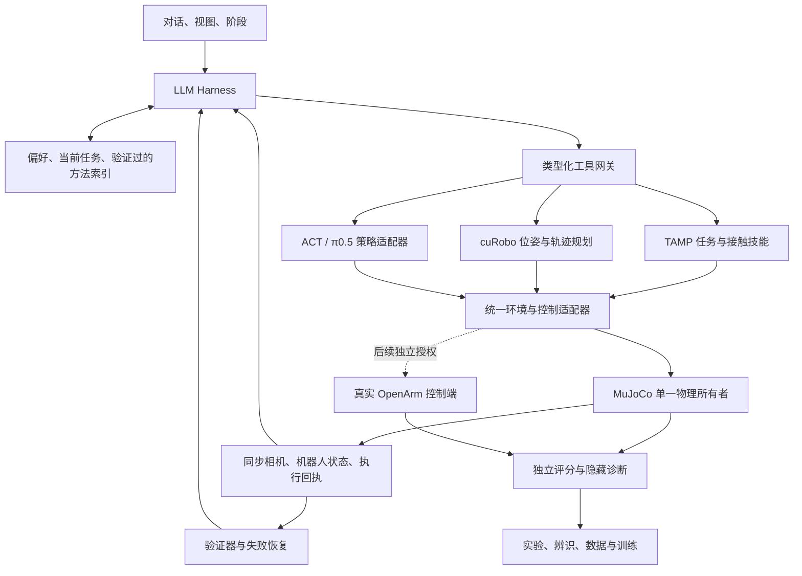

# OpenArm 仿真平台长期路线图

当前优先级（2026-10-13）：见[长期执行计划](执行计划.md)。本文件继续保存旧阶段与历史证据；服务状态和下一步须按新计划重新核对。

更新：2026-10-11。用途：持续执行和交接；先读配套的 [交接说明](交接.md)。本文件中未标完成的能力仍属计划。

## 当前实施进度

- **阶段 A 已完成**：统一只读收集器回收了三项既有成功、混合运动和失败记录；没有新运动或模型请求。证据见[阶段A基线](../runs/20261011-baseline/README.md)。
- **阶段 B 正在进行**：单臂瓶子桌面放置的目标条件自然排序已在本地源码实现，六个冻结场景完整候选搜索6/6通过，误差1.479–2.357 mm；工作台安装的`TaskBottlePick`类在原失败起点复核通过。8767 已加载新源码哈希。旧8例命令重放8/8精确（非重新规划回归）；固定“TAMP抓取—交接—放篮”新源码回归3/3。旧四例方块/圆柱4/4与定向交接try-8的2/2代码清单均与当前相应规划器源文件哈希一致，无须重复耗时仿真。未知物体类别仍未覆盖；页面 API 验收因 DeepSeek HTTP 402 未通过，见[抓取候选审计](../runs/20261011-grasp-audit/README.md)。
- **阶段 C 正在进行**：本地导出材料的完整性、三轨迹时序、图像关联和标定范围审计完成；独立实物标定与动力学辨识仍缺外部测量。报告见[本地标定证据审计](../runs/20261011-calibration-audit/README.md)。
- **阶段 D 部分完成**：终局视觉复查已改为隔离盲审：仅发送当前三路相机与本体状态，不带旧对话、记忆、运行状态或仿真真值工具。139项 harness/契约测试通过，8767已重启加载。真实模型端到端复查仍因HTTP 402未验；对象定位、相机变换、遮挡/误检测量与视觉控制均未完成。
- **阶段 E 部分完成**：ACT 七文件哈希、输入输出维度和当前部署契约已核对；旧闭环记录的 112 动作后右夹爪轻微越过训练统计上限，根因与步长配置差异仍需核实。只读发现公司主机有约9.39GB的LeRobot格式π0.5检查点，但未记录官方OpenPI源码版本，训练数据路径不可用；未复制或运行。详见[模型契约审计](../runs/20261011-policy-audit/README.md)。
- **尚未完成**：阶段B页面/API闭环及杯子/书本/任意视觉物体覆盖；阶段C独立实物标定；阶段D视觉定位与闭环；阶段E ACT根因复现及π0.5官方OpenPI数据/检查点训练评价；阶段F配对实物迁移。物理标定与迁移未证明。

## 1. 最终目标与完成条件

建立可追溯的 OpenArm real → sim → real 平台：用户给自然语言目标，LLM 选择 TAMP、cuRobo 或兼容 VLA；执行器提供真实运动反馈；验证器判断完成、失败或不确定；实验系统支持辨识、训练和回归。

“通用”应体现在新的物体位置、目标、障碍和动作组合中重新规划，而不是为每个案例写一条轨迹。不能承诺任何物理动作都能完成；不可达、感知不足、未提供技能或超出机器人能力时，必须给出可核验的原因。

最终完成需要同时满足：

1. **工具闭环**：LLM 从新观测选工具、接收结构化反馈、恢复或结束；阶段由模型声明，完成由执行证据确认。
2. **动作泛化**：在冻结的独立场景中验证位置运动、抓取、搬运、双向交接、桌面与容器放置，以及多物体组合；明确覆盖的形状与范围。
3. **视觉条件**：机器人决策使用相机、机器人状态和感知估计；仿真真值只供独立评分与诊断。oracle 模式与视觉模式分别统计。
4. **物理一致性**：几何、相机、动作语义、时序、控制响应和接触参数有独立测量、来源和不确定度。
5. **策略接入**：ACT 与 π0.5 均有明确检查点、输入输出和闭环评价；“能推理”与“能完成任务”分别验收。
6. **迁移证据**：同一任务、同一策略与工具契约在仿真和真机配对测试；报告差距与失败，不能以仿真通过推断真机通过。
7. **产品体验**：保持左对话、右上视图、右下阶段；诊断按需展开，过程可追溯，主界面简洁。

软件闭环和真实迁移是两个里程碑。独立测量或真机授权未到位时，继续软件工作，但保留 `transfer_ready=false`。

## 2. 当前基线：哪些已实现，哪些未完成

| 部分 | 当前事实 | 证据与限制 |
|---|---|---|
| 工作台 | 8767 在线；API、模型阶段、工具过程、关键帧、相机视图、记忆已接入 | 最新接入检查见 `runs/20261010-variation/deployment.json` |
| 日常前放 | 页面普通中文请求：右抓、独立持稳10秒、cuRobo前移8厘米、放置与复查完成 | 8次API、65.947秒仿真时间、落点1.78mm；`ui-forward/verified.json`，不是实物精度 |
| TAMP | 参数化左右手、已登记物体抓取、交接与放置；旧演示保留 | 主要使用显式仿真几何；仍不是开放物体感知与完整通用符号规划 |
| cuRobo | 本机GPU规划、当前世界与锁定关节更新、原生路径复核 | 空手或登记物体的单臂携物；双臂同步带载及未知形状未普遍验证 |
| 新变化测试 | 相同8案例：默认PD 5/8，PD稳定等待/高度提示7/8 | 原目标、10秒完整审计、120秒预算保持；开发案例不是总体成功率 |
| 源码控制候选 | 对齐部分控制方程与内部状态代理；两项固定API闭环已通过 | 未独立辨识控制历史；新8案例6/8，多项组合反而4/8，未部署 |
| ACT | 真机权重只读导出；官方LeRobot固定版本；LLM可选策略工具 | 接口就绪；严格完整任务仍失败，夹爪预测曾越界，未裁剪制造成功 |
| π0.5 | LIBERO研究/训练与OpenArm接入是不同契约 | 当前没有已验证的OpenArm π0.5闭环；不能直接套LIBERO权重 |
| 记忆 | 精炼索引、方法去重、按需取证、场景失效与版本筛选 | 原始证据保存在实验档案；不能把旧目标或模型判断当作新观测 |
| 标定 | URDF/坐标/记录时钟等软件数据对齐，部分相机与动力学候选研究 | 安装变换、独立相机参数、实物TCP、夹爪、接触与迁移仍缺证据 |

### 最新未部署研究结论

`runs/20261010-place/` 研究了右手后放失败：

- 原生指令复跑的记录机器人状态与瓶子位置误差均为0；这只说明同一仿真条件复现，不证明实物标定。
- 几何预判到实际持物的关系变化约36mm、0.371rad；一次观测不足以当作普适修正量。
- 更广的逆解起点、放置关节余量、允许姿态锥的诊断都未找到可用下降解。搜索耗尽不能证明物理不可达。
- ±15°倾角在单项测试曾通过；完整8案例负倾角6/8、正倾角5/8。前者损失左手前放与右手侧移；后者还出现稳定等待/持稳失败。
- **不能部署一个固定倾角来宣称修好了通用抓取。** 应研究预测实际夹持关系、面向任务的候选选择和带载可达性。

## 3. 目标架构与职责

- **LLM**：理解目标、分阶段、选择技能、利用反馈和历史方法。不给它承担电机控制或凭文字认定成功的职责。
- **TAMP**：根据当前物体、支持面和约束生成候选，检查可达性与连接，执行接触技能；动作序列不能只依赖任务名称。
- **cuRobo**：解决位姿与路径问题；不负责证明抓住、交接成功或物体稳定支撑。
- **VLA**：在声明的机器人、相机、动作空间及任务分布内生成动作；缺兼容检查点时明确不可调用。
- **验证器**：机器人到位、接触/夹持、物体目标、释放和支撑分别验证。模型视觉判断与独立物理评分分开。
- **训练编排器**：LLM只能提交受约束的训练/评价配置；检查点晋级由留出评价决定，不由模型一句“成功”决定。

### 工具契约统一

后续逐步统一到：`observe`、`perceive`、`move_to_pose`、`move_relative`、`set_gripper`、`pick`、`handover`、`place`、`run_policy`、`get_run_status`、`finish`。旧固定演示继续单独可用。

每项运动请求至少绑定：对象/机械臂、坐标系、观测ID、原任务目标、限制、执行后端。返回：状态、失败码、是否开始运动、前后观测、执行ID、目标误差、耗时和证据来源。

明确区分 `proposed`、`accepted`、`executing`、`verified`、`failed`、`cancelled`。规划成功不等于执行成功；接触抬升不等于长期持稳；TCP到位不等于物体到位。

## 4. 分阶段实施顺序

时间是单人工作的粗略工程投入，**不是达标承诺**；真实测量、硬件授权和模型训练排队另计。按A→F顺序持续推进；上一阶段未达验收条件时，保留失败证据并先解决该阶段的最小问题。

| 阶段 | 建议投入 | 主要产物 | 进入下一阶段的条件 |
|---|---:|---|---|
| A 固定基线与减负 | 已完成 | 小型状态清单、统一结果收集、成本指标 | 可定位一次失败，原生与模型结果不混淆；页面和现有能力保留 |
| B 通用抓取/放置 | 3–7天 | 面向目标的候选搜索、实际夹持预测/恢复 | 冻结旧案例不退化；新起点与物体测试有明确覆盖和失败归因 |
| C 标定与辨识 | 2–4周，视实测条件 | 独立参数包、留出数据、误差预算 | 视觉/运动/接触误差均能解释，候选与实测参数不混用 |
| D 视觉工具闭环 | 1–2周，依赖C | 感知估计、遮挡处理、无对象真值的模型输入 | 在独立场景测定位、闭环任务与恢复，oracle对照单独列出 |
| E ACT/π0.5 | 2–6周，依赖数据和算力 | 固定推理契约、训练与晋级流水线 | 严格闭环有效；留出任务优于或解释与基线的差距 |
| F 配对迁移 | 多轮迭代；需新增授权 | 仿真/真机成对评价、保守部署门槛 | 真实执行证明迁移；用失败差异反推参数/感知/控制问题 |

### A. 固定基线与减少重复工作

1. 保留8767当前已验证部署和8765主服务，不因研究候选随意重启。
2. 把散落在实验脚本中的结果收集统一为一个小型通用收集器：支持绝对/相对运动、成功与失败、原生等待和API等待；必需字段预先校验。
3. 冻结实验目标、模型、控制器、策略、工具版本、时间模式和评分阈值；诊断结束后再改源文件。
4. 每轮只输出简短状态和失败类别汇总。数组、相机原图、IK残差、接触/关节轨迹写入当前实验档案。
5. 清理是规划性工作：只清理自己新建且已确认不用的缓存；归档需保留的失败。不要移动已有报告引用的目录，也不要删除他人文件。

**验收**：同一个任务无需再运动就能复核；采集脚本自身失败与机器人任务失败分开；实验报告不因文件搬迁失效。

### B. 通用抓取、搬运与放置

**先解决核心差距**：当前抓取几何模型与执行后的夹持关系不一致，理想放置预判无法保证实际下降。

建议顺序：

1. 从已有轨迹分析偏差发生在接近、闭合、抬升、稳定等待还是搬运；先复用已录指令，别立即再调用API。
2. 在独立复制的模型/状态中预测原生闭合与抬升，验证预测与实际一致后，才把它用于候选排序。预测不能写回真实所有者状态。
3. 评估候选的接触几何、实际夹持稳定性、关节/电机余量、搬运路径和原目标下降能力；保存拒绝原因。
4. 先支持当前圆柱/方块等形状族，再扩展短圆柱、杯子、书本。复杂物体需要真实碰撞形状与对应技能，不能只增加图标。
5. 每项技能执行后重新观测实际夹持关系。需要恢复时，保持原目标；若涉及放回重抓，必须显式规划、接触验证和计时，不能在后台重置。
6. 对同步双臂、堆叠、打开抽屉等能力另立技能与约束；未实现时明确边界，不能强行复用“抓瓶→交接”。

#### 2026-10-11 候选审计进展

- 原生默认在六个冻结单臂桌面放置场景中为5/6；唯一失败为`right-back / placement_unreachable`。原因链已定位：理想夹持关系前瞻可达，原生抬升后的仿真实际夹持关系前瞻不可达。
- 在隔离 MuJoCo 进程中，瓶盖候选（z=1.205 m、yaw −15°、pitch 0°）六例均通过原生抓取、10秒持稳和原目标放置，最大误差2.501 mm。汇总与边界见[候选审计](../runs/20261011-grasp-audit/README.md)。
- 这仅支持继续验证候选顺序的假设；强制候选成功不等于自然规划器能发现，也不代表任意物体、双臂交接、视觉或实物表现。
- 随后在本地单臂 `next_placement` 分支加入完整候选池排序：较高抓取带优先，接近方向按当前机械臂肩部到瓶子中心的方位排列； pitch 和归一化力臂作后续排序。完整候选保留，所有原生门槛不变。
- [自然排序审计](../runs/20261011-grasp-audit/candidate_natural_study.json)记录六场景6/6通过、左后场景保留两次原关节余量拒绝、放置误差1.479–2.357 mm；[旧8例动作回放](../runs/20261011-grasp-audit/regression_after_rank.json)仍为精确复现。这个回放不等于重新规划回归；两者报告不得合并成总体成功率。
- 当前排序源码已部署到 8767，manifest 哈希与工作区新哈希一致。页面真实 API 复核因 HTTP 402 失败，未通过页面验收，也未计作任务执行成功；见[失败记录](../runs/20261011-grasp-audit/ui_api_402.json)。
- 部署后原固定“TAMP抓瓶→双手交接→放篮”三种初始姿态3/3通过，运行清单确认使用新排序源码哈希；详见[回归汇总](../runs/20261011-204038-tamp-check-691ca5/summary.json)。这是固定任务回归，不是未知动作或 API 测试。先前定向 ObjectHandover 的2/2仍为改动前证据。
- 新方向的带载 cuRobo 转运回归未做；当前 ACT 与 cuRobo 服务进程仍占 GPU，故本轮未启动额外 GPU 转运实验。
- 现有[四个方块/圆柱体原生任务](../runs/20261009-objects/results.json)来自独立`ObjectPlanner`分支，4/4完成；这说明已有形状覆盖，不表示新瓶子排序改变了这些物体的候选策略。杯子、书本及任意视觉对象仍未验证。

**测试阶梯**：单一失败→同一代码复验→既有案例回归→新起点/距离/障碍→新物体→真实API→页面。底层失败时暂停API扩测，先查原生证据。

**晋级条件**：原测试目标与阈值不变，旧能力无材料退化，新覆盖可重复；独立留出结果和耗时明确。8个开发案例8/8也不能宣称任意动作。

### 2026-10-11 本地标定证据审计

- 本地已有三条完整局部轨迹（2,522帧）和33个时点的三路原始图像；源轨迹/采集/图像 manifest 关联、99张 JPEG 哈希及8份导出源码哈希全部核验通过。真实 logger 频率约27.06–27.75 Hz，最大间隔约170–172 ms；数据中的30 fps只是视频/导出元数据，logger 时间也不是曝光或 CAN 下发时间。
- 已发现旧 `reference/README.md` 把图像数量写作36，实际 manifest 是33组三路图像，文档已纠正。`calibrate.json` 的 base→cell 零 FK 残差是软件同源一致性证据；不能作为独立实物标定。当前 `sim/calibration.json` 以 `software_match` 标记几何比对，基座仍为 `candidate`。
- `calib/left.yaml` / `right.yaml` 是 VR 控制器到腕部变换，不是相机外参；`chest.yaml` 标为 TODO。三路相机的K、畸变、相机到机器人变换和曝光同步均无实测证据。
- 数据支持记录文件和记录时钟审计，不含独立物体真值、任务成功标签、采集时的控制器不可变版本、关节反馈与CAN发送时间。已有控制器候选在留出轨迹上退化；本轮不做新拟合或改运行参数。逐项结果见[审计报告](../runs/20261011-calibration-audit/README.md)。

### C. 独立标定与动力学辨识

| 项目 | 必须获取的真实证据 | 验证方式 | 当前主要缺口 |
|---|---|---|---|
| 机器人几何/TCP | 采集时URDF版本、关节零位、TCP定义与实测点 | 多个独立姿态测位置/朝向；留出验证 | 软件FK一致不能代替实物测量 |
| 安装/桌面 | 左右基座、桌面、世界坐标的刚体变换与尺寸 | 多点平面与距离检查 | 0.15m安装高度仍为候选 |
| 相机 | 每路K、畸变模型、分辨率、相机到机器人变换、时间戳 | 标定板/已知结构，多姿态与留出重投影误差 | 头部鱼眼与腕部真实安装参数未独立完成 |
| 夹爪 | 命令/反馈电机角、实际开口、传动、零位与力矩定义 | 多开口尺寸测量和重复性 | 数据极值不是传动标定；333N不是已测电机限矩 |
| 控制与时序 | 采集版本、控制模式、增益、限幅、时延、差分/积分语义 | action→state对齐，空载/带载多轨迹 | SourceMIT内部初值是仿真代理 |
| 物体/接触 | 尺寸、质量、重心、惯量来源、摩擦、夹指表面 | 静置/滑动/抬升等可分辨实验，独立留出 | 瓶子/篮子与接触模型仍有假设 |

每个参数记录：数值、单位、坐标系、来源、测量日期、有效硬件版本、误差/区间、辨识方法、拟合集和留出集。

保持五层验证分离：运动学回放、命令控制回放、接触结果、视觉匹配、VLA闭环。先辨识能从数据中区分的参数；现有数据无法唯一确定的参数标 `UNKNOWN`，补测后再决定。

误差门槛由任务允许误差预算推导：例如小目标抓取需要物体定位、TCP、相机与控制误差的组合小于有效夹持余量。不要直接把仿真1–3mm落点误差作为实物精度要求或标定证明。

公司电脑保持只读；实物采集、CAN查询、相机启动和机器人动作须取得对应范围的新授权。只读数据足够开展离线分析，不足以自动证明所有物理参数已标定。

### D. 从oracle转到视觉闭环

**已完成的隔离子项**：任务终局的独立视觉复查使用新盲审回合，只能`observe`或`finish`；提供当前三路图像与白名单本体状态，不继承执行对话/长期记忆，不显示仿真运行状态、oracle工具或评分字段，仿真也不会因复查 API 等待而继续推进。回归测试将真值字段和旧oracle文本注入复查输入后确认未泄露。该项仅是终局视觉判读隔离，不是端到端视觉闭环。

1. 保留oracle模式作为低层规划上限与失败诊断；另开严格视觉评价模式。
2. 给LLM的输入：固定三路相机、机器人状态、感知对象ID/位置估计及不确定度、可执行工具、当前任务账本。
3. 仿真对象坐标、碰撞真值和任务评分只给独立评价器。审计输入载荷，防止通过提示、记忆或工具回执泄漏真值。
4. 建立相机估计→世界坐标→TCP的统一变换，保留时间戳与对象跟踪身份；低置信度时重新观察，不能编造坐标。
5. 先测独立定位误差、遮挡与误检，再测抓取/放置；视觉成功率与oracle成功率不能混合。
6. 深度、点云或视觉模型按已有硬件与API支持选择；先确认数据与标定是否存在，不因项目用了某模型就重装整套工具链。

### E. ACT与π0.5及训练编排

**已完成的离线子项**：固定ACT模型文件哈希与本机LeRobot版本通过核对；现有预测/统计显示右夹爪输出超已记录动作支持范围`0.00623σ`，不因此擅自限幅或晋级。找到了只读的远端LeRobot π0.5候选目录，但没有OpenPI源码/修订版的可核验证据，且其训练数据路径不存在；因此没有导出9.39GB文件或开始GPU训练。证据见[模型契约审计](../runs/20261011-policy-audit/README.md)。

**ACT先修契约与域差距**：保留固定权重、归一化、RGB预处理、相机顺序、32步预测/16步执行/30Hz等当前协议。查夹爪越界来自训练标签、映射、统计量、相机域还是推理配置。诊断性限幅另列，不替代严格评测。

**π0.5使用官方OpenPI**：先确认OpenArm数据可导入、16维动作语义和三相机适配正确；LIBERO模型不能直接当OpenArm模型。冻结预训练检查点、数据版本、归一化与训练配置，再做小规模验证和正式微调。

**算力**：本机曾按16GB显存配置训练，开始前重新查实际GPU和占用。LoRA、冻结视觉编码器、梯度累积等是资源方案，不保证等价官方训练。记录有效batch、学习率、精度、吞吐、峰值显存和每次检查点评价。

**LLM训练工具**：只允许提交有资源上限、数据哈希和输出目录的配置；返回作业ID，异步收集指标。禁止静默覆盖权重、自动加大资源、靠训练loss晋级。

评价至少比较：TAMP基线、直接ACT/π0.5、LLM+TAMP、LLM+VLA、混合路由；任务、初态、时限与模型输入一致。混合优势需来自工具互补、恢复和长任务，不能用不公平预算比较。

### F. 仿真到真机的配对迁移

先离线接口与限位检查，再经独立授权开展低风险动作，逐步到抓取、放置与双臂交接。保留监护、停止与失败处理机制，但具体硬件策略需依据真实部署确定。

每个配对任务绑定：原始场景、物体尺寸/重量、相机/控制版本、目标、检查点、工具、等待模式、重复次数和判定方法。拆解差距：视觉偏差、跟踪/时延、夹持滑移、接触碰撞、规划不可达。

参数随机化围绕实测误差区间进行；不随意调摩擦或力矩到“仿真好看”。训练与评价场景分开。跨物体或硬件版本迁移需要新证据。

## 5. Harness记忆与上下文的长期设计

保留三层，分别拥有失效条件：

| 层 | 内容 | 读取规则 |
|---|---|---|
| 持久偏好/规则 | 用户偏好、稳定工具契约、版本化能力边界 | 少量默认加载；与实验结果分开 |
| 当前任务账本 | 原目标、剩余预算、已确认阶段、正在执行的回执、最新观测ID | 每次决策刷新；物体状态随观测失效 |
| 方法索引与证据档案 | 已验证的方法、失败补救、适用条件、证据ID；原始轨迹单独保存 | 默认只读短索引；模型需要时展开 |

方法去重基于技能、对象形状族、机械臂/方向、后端、控制/策略契约、障碍条件与失败原因；不按每个坐标生成新记忆。矛盾结果保留，降低可信度，不用最后一次成功覆盖历史失败。

记忆晋级须有原生回执和复验；模型语言判断、单次微小移动、取消与启动失败不自动形成长期技能。旧研究版本可追溯，但不当作当前能力。

先优化索引和确定性检索；只有规模/召回评测证明需要时才引入向量数据库。用户面板只呈现偏好、方法和少量关键失败；细节在实验记录，不重建“原始记忆”入口。

## 6. 评价、反馈与效率规则

### 统一评价表

每次保存：任务及初态、源哈希、模型/控制参数、策略检查点、相机与感知条件、原目标、API成本、仿真/墙钟时间、失败码、接触/稳定指标、最终独立判定。

用例覆盖：左右前后/横向/斜向、不同距离、双向交接、桌面/容器、多对象和占位、遮挡、不可达、取消、接口失败。避免只有成功演示。

评测分三组：开发案例、冻结回归、独立留出。候选选择在开发集完成；留出失败不能删除或变成开发成功率。最终报告列失败、耗时、API调用分布和不确定性。

### 给开发者的隐藏反馈

保存候选拒绝统计、IK位置/姿态残差与限制关节、实际夹持变化、接触力/滑移、带载姿态、电机/力矩余量、GPU缓存与故障、API上下文用量。默认主界面不显示这些数组。

### 节省token和实验成本

1. **先读交接两页和当前失败文件**，不要扫描全部历史或复制长README。
2. **一个假设、一个小对照**；根据结果再扩大。一次失败已经能否定某方案时不要继续同类大批。
3. 底层原生未通过时，不启动大批真实API；收集器失败时复核同一次结果，不为补日志重新运动。
4. 利用结果摘要与`rg`定位。默认工具输出限制1–3k tokens；大数组写档案。
5. 只加载当前阶段工具、最新必要图像和少量记忆。记录输入/输出tokens、缓存命中、费用与耗时，再决定优化方向。
6. 模型上下文不能为省token丢失原目标、失败条件或动作契约。先试确定性摘要，必要时按证据ID展开。
7. 活任务与源代码版本保持一致；改变代码前确认任务终止。等待超时后继续查同一作业，不复制启动。
8. 不默认新增服务、框架、仿真引擎、插件或外部模型。已有MuJoCo与cuRobo先用好。

## 7. 页面与美学

沿用当前基本布局和暖白/低对比风格。需要增强的是理解与操作效率：

- 左侧每项任务显示目标、当前状态和可展开调用记录；失败给简短可理解原因。
- 技能页按TAMP/cuRobo/ACT/π0.5切换，显示当前可用能力及限制；接口就绪不显示成任务已验证。
- 右上观察相机可自由切换；三路模型相机保持固定，不因用户拖动改变模型输入。
- 右下阶段显示模型本次计划及实际验证；不要预设所有请求都走同一瓶子演示。
- 物品以图标按需添加；复杂配置、投影调试、标定详情和隐藏反馈放到详情页。
- 对小字和技术提示做信息分层；主页面保留关键状态，必要解释按需展示。

UI验收需要实际页面截图、基础交互、窄屏和数据加载验证；不能只看源码认为“漂亮”。

## 8. 参考项目：借鉴范围与不借用的结论

| 项目 | 借鉴内容 | 在本项目中的边界 |
|---|---|---|
| [Pigey 仿真harness](https://github.com/lianegalanti/Pigey/blob/main/sim/README.md) | 异构工具、每步观测、VLA子目标、验证 | 其视觉输入不提供对象真值；我们当前oracle结果不可直接比较；LIBERO/Franka不是OpenArm标定包 |
| [MoveIt Task Constructor](https://moveit.picknik.ai/main/doc/tutorials/pick_and_place_with_moveit_task_constructor/pick_and_place_with_moveit_task_constructor.html) | 生成、传播、连接阶段；端到端候选组合 | 先借鉴候选与失败结构，不急于安装ROS或替换当前后端 |
| [TiPToP](https://github.com/tiptop-robot/tiptop) | 视觉到任务/运动规划的组织；明确能力边界 | 未接入；具体借鉴前固定版本；参考[官方限制](https://tiptop-robot.readthedocs.io/en/latest/limitations/) |
| [OpenPI](https://github.com/Physical-Intelligence/openpi) | 官方π0.5训练、数据适配与策略服务 | OpenArm数据/动作/相机须适配并验证，不复制LIBERO成绩 |
| [LeRobot](https://huggingface.co/docs/lerobot/en/index) | 数据、训练与机器人/策略适配 | 当前ACT固定版本为基线；不要一边评价一边升级依赖 |
| [MimicGen](https://github.com/NVlabs/mimicgen) | 从示范生成仿真数据的思路 | 可在场景与接触已可靠后研究；不是物理标定工具，也不证明迁移 |
| [MuJoCo官方文档](https://mujoco.readthedocs.io/en/stable/modeling.html) | 原生物理、接触与参数语义 | 数值稳定不等于与实物匹配；参数变更单独登记 |

优先实现本项目缺失的契约与测量。参考项目不需要全部安装，也不能代替实验。

## 9. Luna第一次接手的明确任务

1. 阅读交接说明，确认8767/8765与正在运行的作业；不要重置当前用户场景。
2. 收尾`20261010-place`研究记录：固定倾角总体退化，不部署；保留原始失败和未执行的新6案例。
3. 选一个具体假设：分析已有记录中的夹持关系变化，提出可验证的原生预测或任务候选过滤；先验证复制状态与原生执行一致。
4. 只跑最小必要对照，保存源码和原目标。通过后再跑旧回归；退化则停下，不继续烧API。
5. 独立列标定缺口，先查本地已有数据是否能回答；需要新实物测量时提交具体测量清单，继续其他不依赖它的工作。
6. 每轮交付：实际改变、通过与失败、证据链接、成本、剩余问题。不要用“计划继续”代替完成动作。

**开始前不要做**：全局固定倾角、放宽夹爪/关节/稳定阈值、改变目标制造通过、重训所有模型、换仿真引擎、写公司电脑、自动启动真机，或把当前目标标完成。
